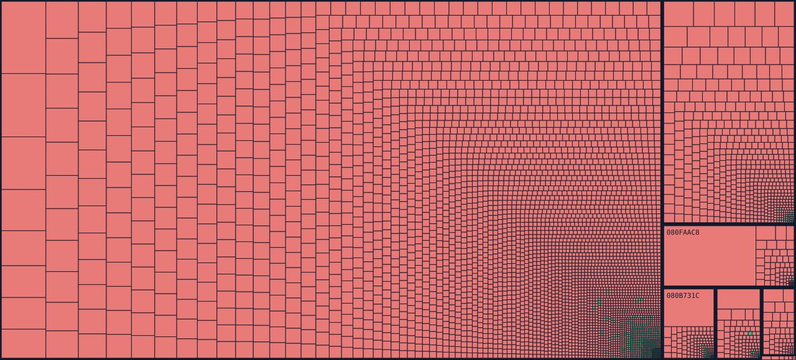

# Drill Dozer (USA) — matching decompilation

**GBA · V49E · Revision 0** · Original ROM SHA-1: `c1058cc2482b91204100cc8515da99aeb06773f5`.

<!-- DECOMP_PROGRESS:START -->
## Decompilation Progress

**3.41%** matched C · **1,959 / 8,160** candidate functions · **35,712 / 1,047,988** bytes.

*Verified by a current byte-identical full-ROM rebuild. Main percentage uses matched tracked-range bytes for a ROM-verified checkpoint; without ROM evidence it uses independent objdiff code bytes where available. The 8,160 ranges are candidate boundaries, not all proven functions.*

*Separate objdiff object comparison: 515 fully matched units, 0.71% of its measured code. This independent metric may differ due to target object construction, relocations or function boundaries, and does not override the byte-identical full-ROM checkpoint.*



[Open the interactive progress treemap](docs/progress.html) (open the HTML directly, or publish `docs/` with GitHub Pages).
<!-- DECOMP_PROGRESS:END -->

## Build

Requires Python 3, GNU Make, GCC (host preprocessor), devkitARM's `arm-none-eabi-*` tools and `agbcc` (run `make deps` once to install agbcc if needed). Put your own **Drill Dozer (USA) rev 0** ROM at `baserom.gba`; never commit that file.

```bash
make deps         # Only if agbcc is not installed
make              # Build ROM, byte-compare, update local progress and map
make compare      # Build ROM + byte-compare (no progress download)
make progress     # Refresh objdiff progress and README map
make clean
```

Expected verification: `MATCH: 8388608 bytes are identical`.

### Conventional linker layout

- `src/**/*.c` is active matched source and compiles into independent `build/obj/src/**/*.o` object files.
- `asm/nonmatching/**/*.s` is active unmatched code (assembled into `build/unmatched.o`).
- `asm/references/**/*.s` is preserved original code for comparing targets; **never linked into the active ROM**.
- `ld_script.ld` uses a simple WL4-style `.text` section listing active objects in ROM order; the full ROM comparison verifies their addresses and sizes. It contains **no assembly include macros, C-slot markers or references to archived ASM**.
- The compiler's temporary `.s` appears only inside `build/asm/`; it is a normal agbcc intermediate, not an active hand-maintained file.

The unmatched `.s` files are combined at build time into one `build/unmatched.s` before assembling. This retains cross-file local branch labels and avoids 5,000+ standalone assembler invocations. No tracked source assembler includes another file.

Promoted functions are listed in `config/matched_functions.json`; every entry compiles from its organized `src/` path and keeps its original assembly only under the mirrored `asm/references/` path.

## Matching a new function

```bash
python3 tools/match_func.py sub_08000988
# Edit src/matching/sub_08000988.c until local MATCH
python3 tools/match_func.py sub_08000988
python3 tools/promote_match.py sub_08000988
make
```

The promotion command archives the original ASM under `asm/references/`, moves your C into the appropriate `src/<subsystem>/` directory, updates the manifest/linker, and performs a full ROM comparison. On failure it rolls back. To revert the active implementation without losing your C:

```bash
python3 tools/promote_match.py sub_08000988 --revert
```

For headers, structs, global declarations and the complete matching process, see [docs/MATCHING.md](docs/MATCHING.md).

## Progress and decomp.fun

`make` automatically attempts an official objdiff report and updates `docs/progress-treemap.svg`, `docs/progress.html`, and the README. If objdiff isn't installed and cannot be downloaded, it uses a **byte-exact local ROM comparison** to mark registered C objects if a verified build is available; otherwise it produces a labeled baseline map. This is not an official decomp.fun objdiff report. For strictly offline builds, use `OBJDIFF_AUTO_INSTALL=0 make`.

The [GitHub Actions workflow](.github/workflows/decompfun.yml) uploads the official `V49E_report` artifact on pushes. decomp.fun admission additionally requires a public repository and at least **5% genuinely matched code**. See [docs/DECOMPFUN.md](docs/DECOMPFUN.md).

The ROM, the compiler and generated object files are excluded from the repository.
